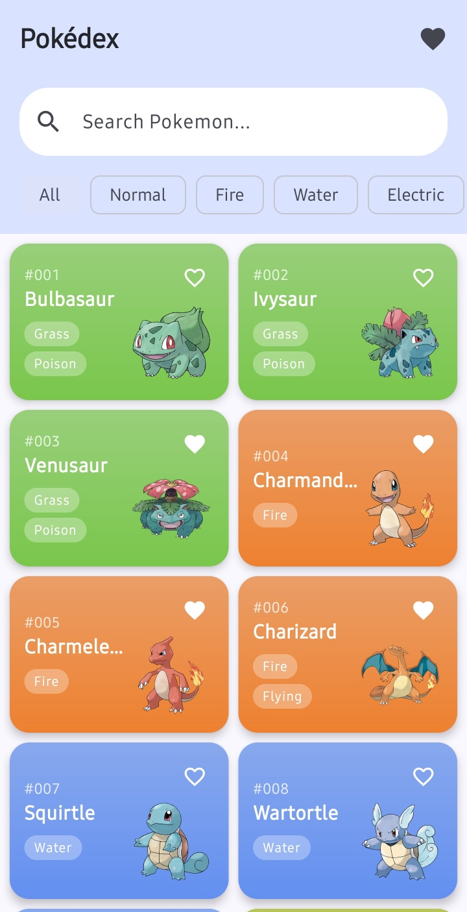
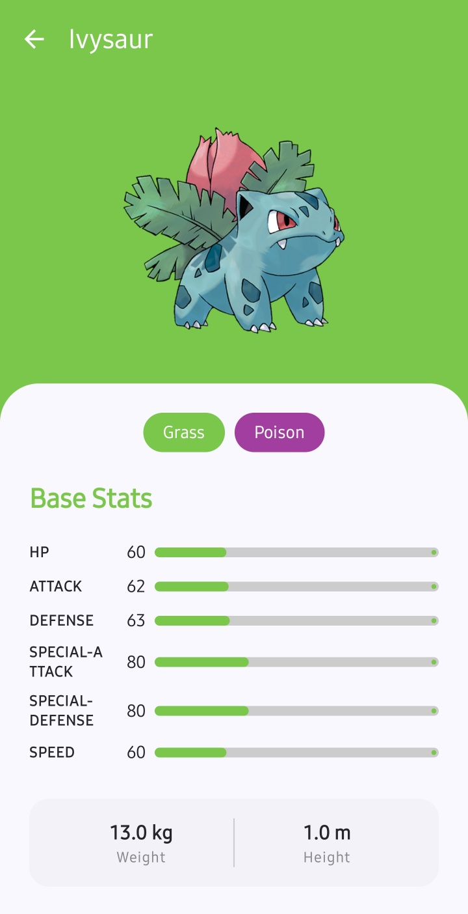
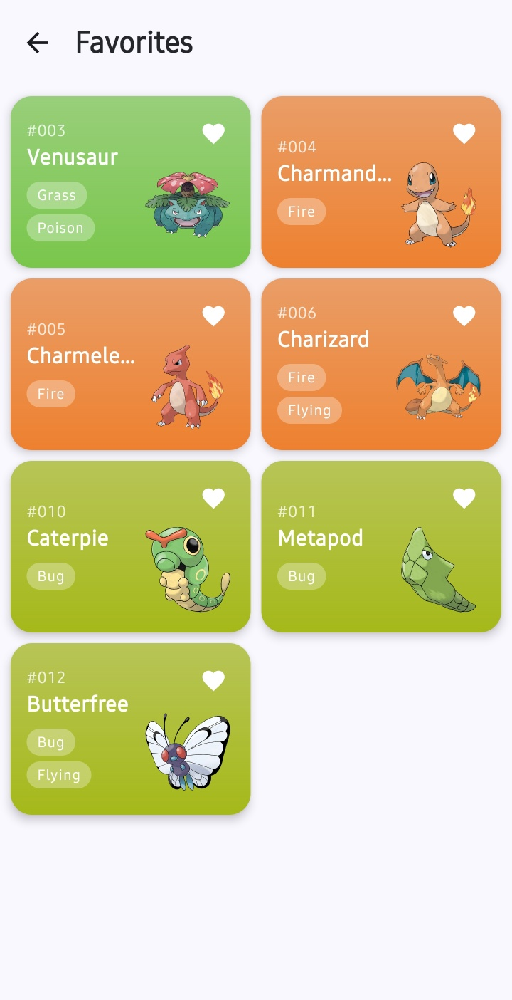

# PokeDex

**Kotlin · Jetpack Compose로 구현한 포켓몬 도감 Android 앱**

[PokeAPI](https://pokeapi.co/)에서 포켓몬 정보를 조회하고, 이름 검색·타입 필터·즐겨찾기로 탐색합니다. Room을 목록의 조회 소스로 사용하고 Paging 3의 `RemoteMediator`로 네트워크 데이터를 저장합니다. 화면은 MVI(Model-View-Intent) 계약으로 상태와 사용자 입력을 구분하고, 기능과 데이터 계층을 멀티 모듈로 분리했습니다.

이 프로젝트에서 중점적으로 다룬 부분은 **로컬 DB와 네트워크를 연결하는 페이징**, **Flow 기반 화면 상태 관리**, **Convention Plugin을 통한 공통 빌드 설정**입니다.

[설계와 데이터 흐름](docs/architecture.md) · [실행·검증 가이드](docs/development.md)

## 화면

| 포켓몬 목록 | 상세 정보 | 즐겨찾기 |
|:---:|:---:|:---:|
|  |  |  |

## 주요 기능

| 기능 | 구현 내용 |
|---|---|
| 목록 탐색 | 2열 그리드, Paging 3 기반 추가 로딩, 초기 로딩 Shimmer |
| 검색·필터 | 저장된 포켓몬의 영문 이름 부분 검색과 타입 필터 조합 |
| 상세 정보 | 이미지, 타입, 기본 능력치, 키·몸무게, 특성 표시 |
| 즐겨찾기 | 목록에서 등록·해제, 별도 즐겨찾기 화면, Room Flow로 상태 반영 |
| 시각적 표현 | 첫 번째 타입에 따른 카드·상세 배경색, 능력치 진행 막대 |
| 로컬 캐시 | DB에 저장된 상세 정보 우선 조회, 미저장 상세 정보는 API 조회 후 저장 |

검색·필터는 **현재 DB에 저장된 데이터**를 대상으로 동작합니다. 저장된 정보는 오프라인에서 조회할 수 있으며, 새로운 데이터와 캐시되지 않은 이미지의 로딩에는 네트워크가 필요합니다. 구체적인 캐시·갱신 정책은 [아키텍처 문서](docs/architecture.md)에 정리했습니다.

## 핵심 구현과 설계 선택

### 1. 목록과 상세에서 같은 로컬 데이터를 사용하기

목록 API 응답의 각 포켓몬에 대해 상세 API를 병렬 호출하고, 상세 데이터와 페이지 키를 하나의 Room 트랜잭션으로 저장합니다. UI는 API 응답을 직접 그리지 않고 Room의 `PagingSource`를 구독합니다. 상세 화면도 저장된 데이터를 우선 사용하므로 목록에서 받은 정보를 재사용합니다.

- [PokemonRemoteMediator](core/data/src/main/kotlin/com/hckim/pokedex/core/data/remotemediator/PokemonRemoteMediator.kt): 페이지 요청, 상세 병렬 조회, 트랜잭션 저장
- [DefaultPokemonRepository](core/data/src/main/kotlin/com/hckim/pokedex/core/data/repository/DefaultPokemonRepository.kt): Pager 구성, 로컬 우선 상세 조회, 즐겨찾기 처리

목록을 표시하기 전에 상세 데이터까지 확보하는 대신 페이지당 요청 수가 늘어납니다. 현재 `pageSize = 20`이므로 일반적인 한 페이지 로딩은 목록 1회와 상세 최대 20회의 요청으로 구성됩니다.

### 2. 화면 상태·목록 스트림·화면 이동의 책임 나누기

각 기능은 `UiState`, `UiIntent`, `UiEffect` 계약을 정의합니다. 검색어·선택 타입·즐겨찾기 ID는 `StateFlow`, 목록은 별도 `Flow<PagingData<Pokemon>>`, 목록 항목 선택에 따른 상세 화면 이동은 `SharedFlow`로 전달합니다.

검색 조건이 바뀌면 `flatMapLatest`로 새 Pager의 Flow를 구독하고 `cachedIn(viewModelScope)`로 페이징 스트림을 캐시합니다. 화면 경로와 `NavController`는 `app`에서 관리하고, feature에는 이동 콜백을 전달합니다.

- [PokemonListViewModel](feature/list/src/main/kotlin/com/hckim/pokedex/feature/list/PokemonListViewModel.kt)
- [MviViewModel](core/common/src/main/kotlin/com/hckim/pokedex/core/common/base/MviViewModel.kt)
- [PokeDexNavGraph](app/src/main/kotlin/com/hckim/pokedex/PokeDexNavGraph.kt)

### 3. 모듈별 빌드 설정의 반복 줄이기

Android/JVM, Compose, Hilt, Room, feature 공통 설정을 `build-logic`의 Convention Plugin으로 구성했습니다. 모듈에서는 필요한 플러그인과 개별 의존성을 선언하고, SDK·JVM target·공통 테스트 설정은 빌드 로직에서 관리합니다. 라이브러리 버전은 Version Catalog에 모았습니다.

- [Convention Plugin 정의](build-logic/convention/build.gradle.kts)
- [Version Catalog](gradle/libs.versions.toml)

## 모듈 구성

| 모듈 | 역할 |
|---|---|
| `app` | 앱 진입점, Hilt 조립, 화면 경로와 NavHost |
| `feature:list` / `detail` / `favorites` | 기능별 Compose 화면, ViewModel, MVI 계약 |
| `core:domain` / `model` | Repository 인터페이스, UseCase, 공통 모델 |
| `core:data` / `network` / `database` | Repository 구현, 페이징, API 통신, 로컬 저장 |
| `core:ui` / `designsystem` | 공통 컴포넌트와 Compose 테마 |
| `core:common` | MVI 계약과 공통 Coroutine 설정 |
| `build-logic` | 공통 빌드 설정을 제공하는 별도 included build |

feature 간 직접 의존성 없이 `app`에서 화면을 연결합니다. 실제 의존 방향과 계층별 절충은 [아키텍처 문서](docs/architecture.md)에서 설명합니다.

## 기술 구성

세부 버전은 [Version Catalog](gradle/libs.versions.toml)와 [Gradle Wrapper](gradle/wrapper/gradle-wrapper.properties), 실행 환경은 [개발·검증 가이드](docs/development.md)에서 확인할 수 있습니다.

| 영역 | 사용 기술 |
|---|---|
| 언어·비동기 | Kotlin, Coroutines, Flow |
| UI | Jetpack Compose, Material 3, Navigation Compose |
| 데이터 | Room, Paging 3 |
| 네트워크·이미지 | Retrofit, OkHttp, Kotlin Serialization, Coil |
| DI·코드 생성 | Hilt, KSP |
| 빌드 | AGP, Gradle, Kotlin DSL, Convention Plugins |
| 테스트 | JUnit 4, MockK, Turbine, kotlinx-coroutines-test |

## 실행 방법

1. 저장소를 클론하고 Android Studio에서 엽니다.
2. **JDK 21**, **Android SDK Platform 37**, **SDK Build Tools 36.0.0**을 준비합니다. Android Studio는 AGP 9.1.1을 지원하는 버전을 사용합니다.
3. SDK 경로가 설정된 `local.properties`를 준비하고 Gradle Sync 후 `app`을 실행합니다. 기본 API URL은 `https://pokeapi.co/api/v2/`이며 별도 API 키 설정은 없습니다.

```powershell
git clone https://github.com/hckim-dev/PokeDex.git
cd PokeDex
.\gradlew.bat :app:assembleDebug
```

최소 실행 버전은 Android 8.0(API 26), `compileSdk`와 `targetSdk`는 37입니다. macOS/Linux 명령, API URL 변경, APK 위치와 환경 문제 해결은 [개발·검증 가이드](docs/development.md)에 정리했습니다. Build Tools 기본값은 [AGP 9.1 공식 호환성 문서](https://developer.android.com/build/releases/agp-9-1-0-release-notes)를 참고했습니다.

## 테스트

프로젝트 동작을 대상으로 **로컬 단위 테스트 19개**와 **Room DAO 계측 테스트 2개**를 작성했습니다. 기본 생성된 예제 테스트는 이 수에 포함하지 않았습니다.

| 대상 | 작성된 테스트의 범위 |
|---|---|
| UseCase | Repository 위임, 반환값·Flow 전달 |
| Repository | 즐겨찾기 추가·삭제 분기, 즐겨찾기 Flow 전달 |
| ViewModel | 검색어·타입·즐겨찾기 상태, 상세 조회 성공·실패, 상세 이동 Effect |
| Room DAO | In-memory DB에서 포켓몬 삽입·조회와 즐겨찾기 추가·삭제 |

```powershell
.\gradlew.bat :core:domain:test :core:data:testDebugUnitTest :feature:list:testDebugUnitTest :feature:detail:testDebugUnitTest :feature:favorites:testDebugUnitTest
```

**2026-10-23 검증 결과:** Debug APK 빌드와 위 단위 테스트 19개가 모두 통과했습니다. Room 계측 테스트와 실제 기기 UI 동작은 해당 검증에서 실행하지 않았습니다. 계층별 테스트 수, 미검증 범위와 수동 확인 절차는 [개발·검증 가이드](docs/development.md)에 있습니다.

## 개선 과제

- 목록 새로고침으로 캐시가 교체되어도 즐겨찾기 항목이 계속 표시되도록 보존 정책 보완
- Paging·상세 조회 오류의 사용자 표시, 재시도와 빈 결과 UI 보완
- Room 스키마 내보내기와 명시적 Migration, RemoteMediator 회귀 테스트 추가

현재 정책과 제약의 근거는 [아키텍처 문서](docs/architecture.md)에 정리했습니다.
