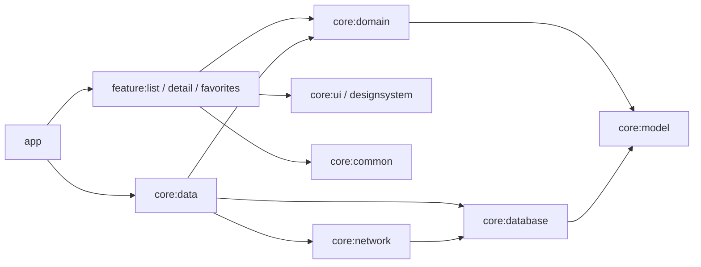
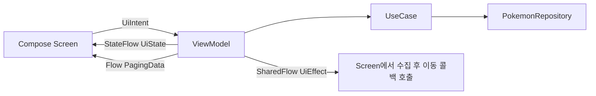
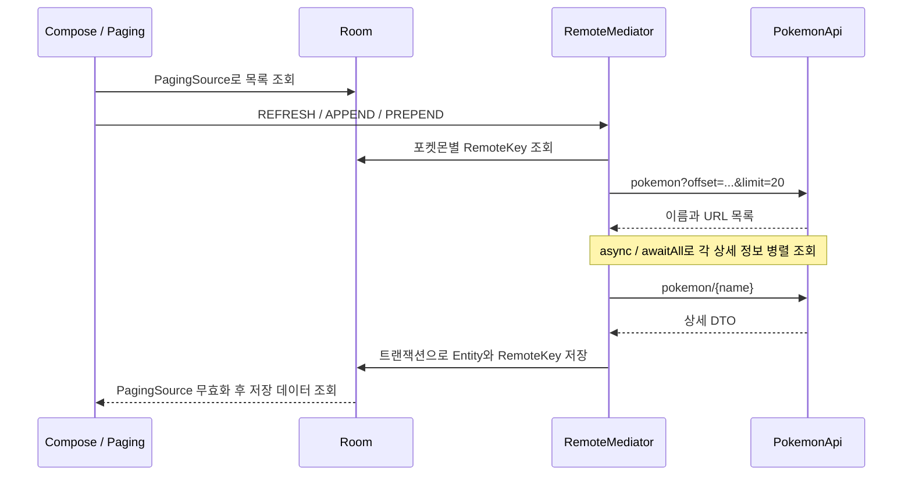

# 아키텍처와 데이터 흐름

[README](../README.md) · [개발·검증 가이드](development.md)

이 문서는 현재 코드의 모듈 경계, 화면 상태 관리, 데이터 저장·조회 정책을 설명합니다.

구현을 따라 읽으려면 [목록 ViewModel](../feature/list/src/main/kotlin/com/hckim/pokedex/feature/list/PokemonListViewModel.kt) → [Repository](../core/data/src/main/kotlin/com/hckim/pokedex/core/data/repository/DefaultPokemonRepository.kt) → [RemoteMediator](../core/data/src/main/kotlin/com/hckim/pokedex/core/data/remotemediator/PokemonRemoteMediator.kt) → [DAO](../core/database/src/main/kotlin/com/hckim/pokedex/core/database/dao/PokemonDao.kt) 순서로 확인할 수 있습니다. ViewModel과 Repository 사이의 UseCase는 아래에서 별도로 설명합니다.

## 모듈 경계

주요 의존 방향은 다음과 같습니다. 화살표는 모듈의 의존 방향이며, 공통 모델·UI 등에 대한 일부 의존성은 생략했습니다.

- **`app`**: `PokeDexApplication`, Activity, Hilt 조립과 Navigation Compose 경로를 담당합니다.
- **`feature:*`**: 화면별 Compose UI, ViewModel, 상태·입력·Effect 계약을 가집니다. 다른 feature나 `core:data`를 직접 참조하지 않습니다.
- **`core:domain`**: `PokemonRepository` 인터페이스와 UseCase를 제공합니다. Android Gradle Plugin을 적용하지 않는 Kotlin/JVM 모듈이며, Coroutines·`paging-common`·`javax.inject`를 사용합니다.
- **`core:data`**: Repository 인터페이스를 구현하고 API·DB를 조합합니다. Hilt의 `DataModule`에서 구현체를 바인딩합니다.
- **`core:network` / `core:database`**: API와 영속성 구현을 담당합니다. 현재 DTO의 `asEntity()`가 DB Entity를 반환하므로 `network → database` 의존성이 있습니다.
- **`core:model` / `core:common`**: 공통 모델과 MVI·Coroutine 계약 등을 제공합니다. 두 모듈 모두 Kotlin/JVM 모듈입니다.
- **`core:ui` / `core:designsystem`**: 포켓몬 공통 컴포넌트와 테마를 구분합니다.

Repository 구현은 Domain의 인터페이스에 의존하고, ViewModel은 UseCase를 통해 데이터에 접근합니다. Domain API에는 `PagingData`가 노출되고 DTO 변환은 DB Entity를 사용합니다. Paging 타입을 그대로 전달하고 DTO를 Entity로 직접 변환하는 만큼 중간 변환 코드는 적지만, Domain은 Paging에, Network는 Database에 결합됩니다.

관련 코드: [모듈 등록](../settings.gradle.kts), [feature 공통 의존성](../build-logic/convention/src/main/kotlin/AndroidFeatureConventionPlugin.kt), [Repository 계약](../core/domain/src/main/kotlin/com/hckim/pokedex/core/domain/repository/PokemonRepository.kt), [DTO 변환](../core/network/src/main/kotlin/com/hckim/pokedex/core/network/model/PokemonDto.kt)

### UseCase의 역할

현재 6개의 UseCase는 각각 하나의 Repository 메서드에 위임합니다. ViewModel은 목록 조회·상세 조회·즐겨찾기 변경 등 필요한 동작을 주입받고, API·DAO나 Repository 구현체를 직접 알지 않아도 됩니다. ViewModel 테스트에서도 UseCase를 mock으로 대체합니다.

이 계층은 동작별 호출 경계를 제공하며, 현재 별도의 검증 규칙이나 여러 Repository를 조합하는 로직은 없습니다. 단순 위임 클래스와 DI 구성이 늘어나는 비용도 있으므로, 도메인 로직의 복잡성과 분리 필요성을 함께 고려할 수 있습니다.

관련 코드: [UseCase 구현](../core/domain/src/main/kotlin/com/hckim/pokedex/core/domain/usecase), [목록 ViewModel 테스트](../feature/list/src/test/kotlin/com/hckim/pokedex/feature/list/PokemonListViewModelTest.kt)

## 화면 상태와 사용자 입력

공통 [MviViewModel](../core/common/src/main/kotlin/com/hckim/pokedex/core/common/base/MviViewModel.kt)은 `uiState`, `effect`, `onIntent()`를 정의하는 인터페이스입니다. 각 ViewModel이 `when`으로 입력을 처리하고 `MutableStateFlow.update`로 상태를 갱신합니다.

목록 화면의 데이터는 다음처럼 나뉩니다.

| 스트림 | 담당 데이터 | 수집 방식 |
|---|---|---|
| `uiState` | 검색어, 선택 타입, 즐겨찾기 ID 등 | `collectAsStateWithLifecycle()` |
| `pokemonPagingData` | `PagingData<Pokemon>` | `collectAsLazyPagingItems()` |
| `effect` | 항목 선택에 따른 `NavigateToDetail` | `LaunchedEffect`에서 수집 |

검색·필터 입력은 `SearchParams`를 갱신합니다. `flatMapLatest`가 이전 목록 Flow 수집을 취소하고 새 조건의 목록을 구독하며, `cachedIn(viewModelScope)`가 페이징 스트림을 캐시합니다.

목록 로딩 상태는 Paging `loadState`를 기준으로 표시합니다. 목록·즐겨찾기에서 항목을 선택하면 ViewModel이 상세 이동 Effect를 방출하고 화면이 이동 콜백을 호출합니다. 즐겨찾기 화면 열기와 뒤로 가기는 화면에서 콜백을 직접 호출합니다.

Effect는 기본 `MutableSharedFlow()`로 replay 없이 전달됩니다. 활성 수집자가 없을 때 방출된 이벤트는 이후 수집자에게 재전달되지 않습니다.

관련 코드: [목록 계약](../feature/list/src/main/kotlin/com/hckim/pokedex/feature/list/PokemonListContract.kt), [목록 ViewModel](../feature/list/src/main/kotlin/com/hckim/pokedex/feature/list/PokemonListViewModel.kt), [목록 Screen](../feature/list/src/main/kotlin/com/hckim/pokedex/feature/list/PokemonListScreen.kt)

## 목록 페이징

검색어가 비어 있고 타입이 선택되지 않은 목록에서만 `RemoteMediator`를 연결합니다. UI에 전달하는 목록의 조회 소스는 항상 Room입니다.

### 페이지와 저장 정책

- `PagingConfig`: `pageSize = 20`, `prefetchDistance = 5`, `initialLoadSize = 40`, `enablePlaceholders = false`
- 실제 API 호출의 `limit`는 `state.config.pageSize`를 사용합니다. `initialLoadSize = 40`이 첫 API 요청의 `limit = 40`을 의미하지는 않습니다.
- `RemoteKeyEntity`의 `prevKey`·`nextKey`는 페이지 번호가 아닌 **offset**입니다.
- `APPEND`와 `PREPEND`는 마지막·첫 항목의 키를 사용하고, `REFRESH`는 anchor에 가까운 항목의 키를 기준으로 offset을 계산합니다.
- 응답의 `next == null`이면 끝으로 판단합니다.
- `initialize()`는 매번 `LAUNCH_INITIAL_REFRESH`를 반환합니다. 캐시 유효 기간에 따른 초기 갱신 생략은 없습니다.

목록 응답을 받은 뒤 각 상세 요청이 모두 성공해야 DB 저장을 시작합니다. 하나라도 실패하면 해당 로딩은 `MediatorResult.Error`로 끝나며 그 로딩의 결과는 저장하지 않습니다. 기존 캐시는 네트워크 실패 시 삭제하지 않습니다.

`REFRESH` 저장 시에는 트랜잭션 안에서 `remote_keys`와 `pokemon`을 비우고 이번 응답을 삽입합니다. `favorites`는 지우지 않습니다. 네트워크 I/O는 이 DB 트랜잭션 밖에서 수행합니다.

### 선택의 이점과 비용

목록을 읽을 때 이미지 URL·타입·능력치를 함께 확보하므로 상세 화면에서 같은 Entity를 재사용할 수 있습니다. 대신 한 페이지에 목록 1회와 상세 최대 20회의 HTTP 요청이 필요하고, 가장 늦은 상세 요청이 끝날 때까지 저장이 지연됩니다. 별도의 동시 요청 수 제한기나 부분 성공 저장 정책은 없습니다. 병렬화가 실제 지연 시간을 얼마나 줄였는지는 측정하지 않았습니다.

관련 코드: [Repository](../core/data/src/main/kotlin/com/hckim/pokedex/core/data/repository/DefaultPokemonRepository.kt), [RemoteMediator](../core/data/src/main/kotlin/com/hckim/pokedex/core/data/remotemediator/PokemonRemoteMediator.kt)

## 검색·상세·즐겨찾기

세 기능이 사용하는 로컬 테이블의 역할은 다음과 같습니다.

| 테이블 | 저장 데이터 | 사용 목적 |
|---|---|---|
| `pokemon` | 상세 정보와 이미지 URL | 목록·검색·상세·즐겨찾기 화면의 조회 데이터 |
| `remote_keys` | 포켓몬별 이전·다음 offset | 기본 목록의 네트워크 페이지 위치 관리 |
| `favorites` | 즐겨찾기 ID와 이름 | 등록 여부와 즐겨찾기 목록의 선택 조건 |

### 검색과 타입 필터

검색어나 타입 조건이 있으면 `RemoteMediator`를 사용하지 않고 DB만 조회합니다. SQL은 `name LIKE '%' || :query || '%'`와 타입 조건을 조합하고 ID 오름차순으로 반환합니다. 타입·능력치·특성은 TypeConverter로 JSON 문자열에 저장하며, 타입 필터는 이 문자열에 `LIKE`를 적용합니다.

따라서 스크롤로 아직 받아오지 않은 포켓몬은 검색되지 않습니다. 검색 결과가 비어 있어도 전체 PokeAPI에 해당 포켓몬이 없다는 뜻은 아닙니다. 검색 조건을 해제하면 네트워크 페이징 경로로 돌아갑니다.

### 상세 조회

`getPokemonDetails(name)`은 DB에서 이름으로 조회하고, 데이터가 있으면 즉시 반환합니다. 없을 때만 API를 호출해 Entity를 저장합니다. DB에 있는 상세 데이터의 만료 시간이나 백그라운드 갱신은 없습니다. 실패는 Kotlin `Result.failure`로 반환합니다.

### 즐겨찾기

`favorites`에는 ID와 이름을 저장합니다. 등록·해제 시 현재 즐겨찾기 여부를 Flow의 `first()`로 읽고 삽입 또는 삭제하며, 화면의 하트 상태는 `getFavoriteIds()`를 구독해 반영합니다. 읽기와 쓰기를 하나의 트랜잭션으로 묶는 원자적 toggle은 아닙니다.

즐겨찾기 목록은 `favorites`에 ID가 있는 **`pokemon` 행**을 조회합니다. `REFRESH`가 이전 `pokemon` 캐시를 비우면 즐겨찾기 ID는 남아도 해당 행이 다시 저장되기 전까지 화면에서 빠질 수 있습니다. 즐겨찾기 데이터 보존 정책을 보완할 때 이 두 테이블의 관계를 함께 고려해야 합니다.

관련 코드: [PokemonDao](../core/database/src/main/kotlin/com/hckim/pokedex/core/database/dao/PokemonDao.kt), [TypeConverter](../core/database/src/main/kotlin/com/hckim/pokedex/core/database/util/PokemonTypeConverter.kt), [FavoriteEntity](../core/database/src/main/kotlin/com/hckim/pokedex/core/database/model/FavoriteEntity.kt)

## 오프라인과 오류 처리의 범위

| 상황 | 현재 동작·제약 |
|---|---|
| 저장된 상세 조회 | DB 데이터 반환, API 호출 생략 |
| 저장된 항목 검색·필터 | DB만 조회하므로 네트워크 요청 없음 |
| 기본 목록 진입 | DB를 조회하면서 초기 네트워크 갱신을 시도함. 로딩 중에는 Shimmer를 표시 |
| 미저장 데이터 조회·추가 페이지 | API 연결 필요 |
| 이미지 | DB에는 URL만 저장함. Coil 캐시에 없는 이미지는 오프라인 표시를 보장하지 않음 |
| 페이지 로딩 실패 | Mediator가 오류를 반환하지만 목록 UI의 전용 오류 표시·재시도는 미구현 |
| 상세 조회 실패 | ViewModel의 `error`에 저장하지만 상세 Screen의 오류 표시·재시도는 미구현 |
| DB 버전 변경 | 명시적 Migration 없이 destructive migration fallback 사용 |

Room은 DB 버전 2이며 `exportSchema = false`입니다. `fallbackToDestructiveMigration(true)`로 설정되어 있어 필요한 Migration이 없으면 기존 캐시와 즐겨찾기를 보존하지 못할 수 있습니다.

관련 코드: [DB 정의](../core/database/src/main/kotlin/com/hckim/pokedex/core/database/PokeDatabase.kt), [DB 생성](../core/database/src/main/kotlin/com/hckim/pokedex/core/database/di/DatabaseModule.kt), [상세 Screen](../feature/detail/src/main/kotlin/com/hckim/pokedex/feature/detail/PokemonDetailScreen.kt)

## 화면 이동과 빌드 구성

`app`의 `Route`는 Kotlin Serialization의 `@Serializable` 타입입니다. `NavHost`에서 `composable<Route.PokemonDetail>`을 등록하고 `toRoute()`로 이름을 복원합니다. feature는 `NavController` 대신 콜백을 받아 화면 이동을 요청합니다.

[build-logic](../build-logic/convention/build.gradle.kts)은 `pluginManagement.includeBuild`로 연결한 별도 빌드입니다. `pokedex.android.application`, `pokedex.android.library`, `pokedex.jvm.library`를 기본으로 Compose·Hilt·Room·feature 공통 플러그인을 조합합니다.

`gradle.properties`에는 병렬 실행·빌드 캐시·Configuration Cache가 활성화되어 있습니다. 이는 설정상의 선택이며, 모듈 분리나 캐시 도입 전후의 빌드 시간 개선 수치를 측정한 자료는 없습니다.

## 후속 개선 우선순위

1. **사용자 데이터 보존**: 목록 갱신 시 즐겨찾기 항목 보존, 스키마 내보내기와 명시적 Migration.
2. **실패 복구 UX**: Paging 오류·재시도, 상세 오류 표시, 검색 결과 없음과 로딩 상태 구분.
3. **동작 회귀 검증**: RemoteMediator의 offset·종료 조건·트랜잭션 실패와 캐시 보존, 검색·필터 SQL, 즐겨찾기 동시 입력 검증.
4. **측정 후 최적화**: 페이지별 요청 수·지연 시간·실패율을 측정한 뒤 상세 병렬 요청 제한이나 부분 저장 정책 검토.
